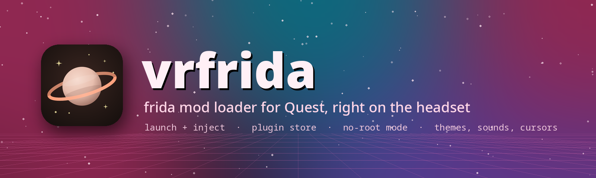
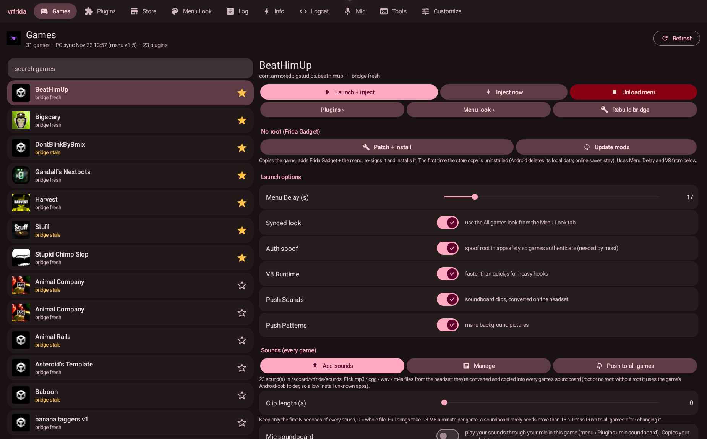
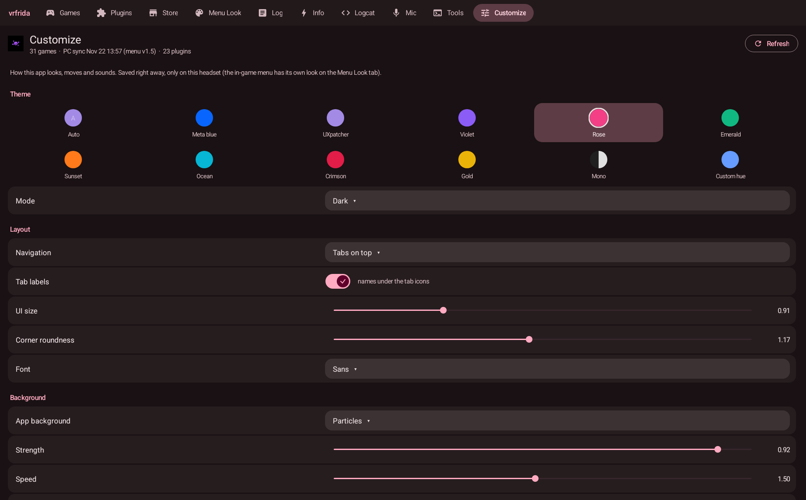
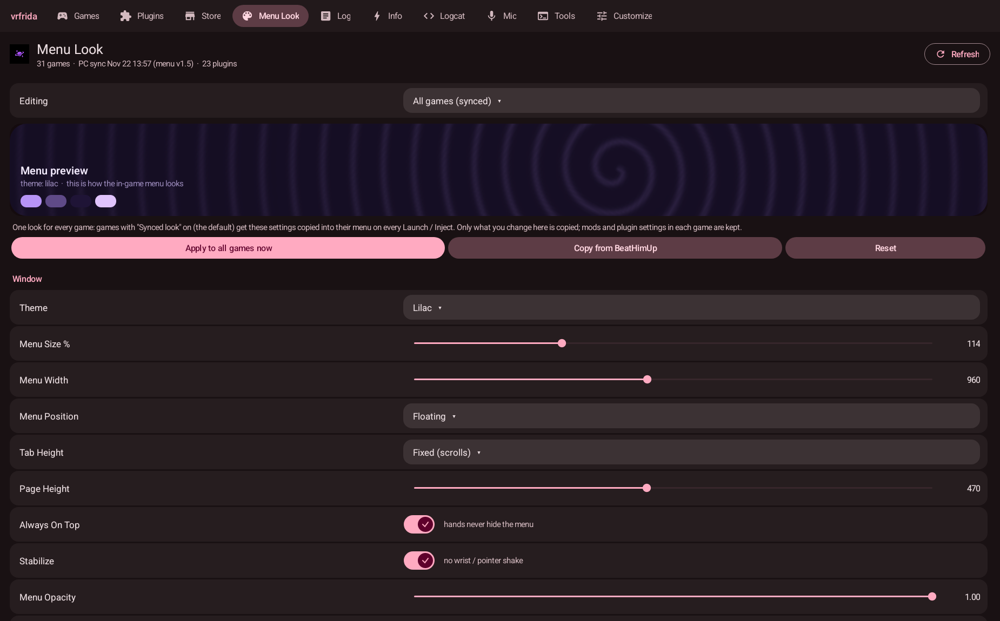
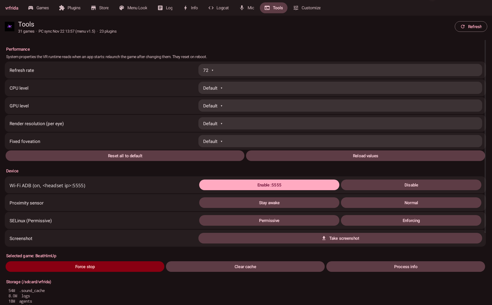
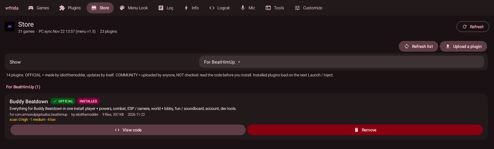

  

  
  
  
  
   
  
  
  
  
  

  <b><a href="https://github.com/idiotthemodder/vrfrida-quest/releases/latest/download/vrfrida.apk">⬇ Download vrfrida.apk</a></b>
  &nbsp;·&nbsp; <a href="#features">Features</a>
  &nbsp;·&nbsp; <a href="#customize">Customize</a>
  &nbsp;·&nbsp; <a href="#no-root-mode-frida-gadget">No-root mode</a>
  &nbsp;·&nbsp; <a href="#build--install">Build</a>

# vrfrida Quest app

A 2D Quest app that does what `vrfrida.py` does, but on the headset with no PC:
pick a game → it builds the bridge, pushes plugins / sounds / patterns into the game,
launches it, waits N seconds after the game process appears, then injects bridge + menu with `frida-inject` (as root).

**With root** (Magisk, accept the su prompt on first open; SELinux permissive helps) you get everything.
**Without root** the app switches to no-root mode: games are still found automatically, and **Patch + install** puts
Frida Gadget into the game itself (see [below](#no-root-mode-frida-gadget)).

> [!NOTE]
> **Who can root?** Quest 3 / 3S: only on older Horizon OS builds. Quest 2 and Quest Pro: the latest Horizon OS too, through **kugel**.
> Everyone else uses no-root mode.

<table>
  <tr>
    <td width="50%">
<b>Games</b>: launch + inject, per-game delay, auth spoof
</td>
    <td width="50%">
<b>Customize</b>: themes, layout, sounds, cursors, boot screen
</td>
  </tr>
  <tr>
    <td width="50%">
<b>Menu Look</b>: the in-game menu's theme, background, laser, sounds
</td>
    <td width="50%">
<b>Tools</b>: refresh rate, CPU / GPU level, Wi-Fi ADB, root shell
</td>
  </tr>
  <tr>
    <td colspan="2">
<b>Store</b>: official + community plugins, installed and kept up to date on the headset
</td>
  </tr>
</table>

## Features

| Tab | What it does |
|---|---|
| 🎮 **Games** | Every installed game, found automatically. Pick one, set the delay, **Launch + inject** / **Inject now** / **Unload**. No-root: **Patch + install**. |
| 🧩 **Plugins** | Turn plugins on / off per game. The `// game:` line decides which ones each game gets, same rules as `vrfrida.py`. |
| 🛒 **Store** | Plugin store from the public store repo. Official plugins update themselves. Community plugins show a warning before every install and update. You can also upload plugins for review. |
| 🎨 **Menu Look** | Edits the selected game's `imgui_plugins/settings.json`: theme, size, background, pattern, laser, pointer, sounds, saving. Live preview using the menu's own colors and textures. |
| 📜 **Log** | Injector + menu console for the game. **Updates** lives here (self-update from GitHub Releases). |
| ℹ️ **Info** | *questfetch* (neofetch for the headset), a copyable debug report, and crash reports (tombstones, crash buffer, the patched game's own log). |
| 🐞 **Logcat** | Every line the game writes (Unity, Normcore, its own Java code), saved to `logs/<pkg>-logcat.txt`. |
| 🎙️ **Mic** | System-wide soundboard (root): plays sounds into the mic for party chat and every game's voice chat. |
| 🛠️ **Tools** | Root toolbox, [details below](#tools-root). |
| ✨ **Customize** | How the app itself looks, sounds and feels, [details below](#customize). |

### Auth spoof
Spoofs root in `com.oculus.appsafety` (same hooks as `~/thing.sh`) so games that check device integrity at startup
still authenticate on a rooted headset. On by default per game. `Launch + inject` / `Inject now` arm it automatically.
A detached root watcher injects the eternalized spoof (`assets/appsafety_spoof.js`) whenever appsafety (re)spawns, so
it survives game restarts. Buttons: `Spoof appsafety now` / `Stop auth spoof`. Log: `logs/appsafety.log`.

### Customize
Everything is saved in the `applook` pref and has a default, so old installs just pick up the new extras.

- **Themes**: Auto, Meta blue, UXpatcher, Violet, Rose, Emerald, Sunset, Ocean, Crimson, Gold, Mono, or any custom hue.
  Each one comes in **Dark**, **AMOLED black** or **Light**.
- **Layout**: navigation rail on the left or right, or tabs on the top or bottom; labels on or off; UI size; corner roundness; font.
- **Animated background**: aurora, particles (they lean toward your pointer), waves, synthwave grid, or the synced menu
  background. Strength and speed sliders.
- **Motion**: press / enter animations, on or off, with a speed slider.
- **Sounds**: 20 UI sounds (click, tab, toggle on/off, open/close, copy, delete, success, error, notify, whoosh...) in
  **7 packs**: Soft (marimba), Glass (bells), Wood (plucked), Minimal, Sci-fi, Bubble, Retro 8-bit. They are made at
  runtime by `UiSfx.java` (no audio files). Tabs play notes on a pentatonic scale and each sound varies a little in pitch,
  so repeats don't get annoying. Volume slider, hover sounds optional.
- **Cursors**: dot, ring, crosshair, arrow, reticle or diamond, with size, color (accent / white / tertiary / rainbow) and
  an optional trail. The cursor grows over buttons and ripples when you click.
- **Hide Quest pointer** (root): hides the system's own cursor over vrfrida's panel, so you only see the custom one.
  `shellagent/vrshell_cursor.js` is injected into `vrshell` and sets the cursor scale to 0 on vrfrida's panel only. A
  root watcher re-injects it after a shell restart. It is tied to vrshell internals, so a new Horizon OS build may break it.
- **Boot screen**: orbit, glitch, pulse or off. Tap to skip.
- **Style codes**: **Copy style code** / **Paste style code** shares a whole look as a `vrstyle:` string.

### Tools (root)
- **VR runtime**: refresh rate, CPU / GPU level, render resolution, fixed foveation. These apply to apps started
  afterwards and reset on reboot.
- **Device**: Wi-Fi ADB on `:5555`, proximity sensor off, SELinux toggle, screenshot to `/sdcard/vrfrida/captures/`.
- **Selected game**: force stop, clear cache, process info.
- **Storage**: usage per folder + cleanup.
- **Root shell** with output.

### App Look
App theme = the selected game's menu (theme + background follow whatever game you pick), UXpatcher (its bg / accent /
text colors through the menu's colorsFromRGB), or any menu theme with the app's own background.
The app is drawn like UniversalMenu: same themes, widgets and animated backgrounds (spiral, sky, blossoms, night sky,
aurora, ..., character pattern). `gen_menu_assets.py` runs the menu's own theme + background code in frida at
build time and saves the colors / generated textures into the apk, so it stays in step with UniversalMenu.ts.

`NOLIB=1 ./build.sh` makes `vrfrida-emu.apk` without frida-inject, for checking the ui on an x86_64 emulator.

## No-root mode (Frida Gadget)
Same patch as `../nonroot/patch_apk.py`, done on the headset (`NoRoot.java`, `ApkPatch.java`, `ElfPatch.java`):
- every apk of the game (base + splits) is copied raw (no recompressing, ~seconds per GB) and re-signed with
  `patchkey/` (apksig from build-tools, dexed into the app). **Keep `patchkey/`**: repatching with the same key installs
  as an update and keeps the game's data; a new key means uninstalling again.
- added to `lib/arm64-v8a/`: `libfrida-gadget.so` (`dl/frida-gadget.so`, official 17.27.0), its config, `libvrfrida-loader.js.so`
  and `libvrfrida-agent.js.so` (bridge + this game's plugins embedded + menu, built at patch time).
- `libmain.so` gets `libfrida-gadget.so` as a DT_NEEDED (new segment for the grown .dynamic/.dynstr, made from PT_NOTE).
- the loader waits for libil2cpp.so + Menu Delay, then loads the first readable of: `Android/data/<pkg>/files/frida/menu.js`
  (PC kit `--push-only`), `/sdcard/vrfrida/agents/<pkg>.gadget.js` (**Update mods** writes it; only if the game can read /sdcard),
  the copy in the apk.
- first install: confirm dialog → OBB moved aside → system uninstall dialog → system install dialog → OBB back.
  Needs "Install unknown apps" allowed for vrfrida (the app opens that page).
- games with `extractNativeLibs=false` (uncompressed libs) get a warning: Gadget may not find its config there.

## App updates (GitHub Releases)
Log tab -> Updates: set `owner/repo` (default from `update_repo.txt` at build time), Check for updates / Update.
The app also checks by itself every 6 h. A release tag `v<N>` newer than the installed versionCode with a `vrfrida.apk`
asset gets offered; the apk must be signed with `vrfrida.keystore` (checked before installing). A `menu.js` asset
replaces `/sdcard/vrfrida/menu.js` only if it's newer than the local one. The repo must be public.
    ./release.sh "what changed"     # bumps version.txt, builds, gh release create v<N> vrfrida.apk menu.js

## Build / install
    ./build.sh              # -> vrfrida.apk  (no gradle: aapt2 + javac + d8 from ~/Android/Sdk)
    ./build.sh install      # build + adb install -r
    python ../vrfrida.py --sync   # push the latest menu, plugins, sounds, patterns, bridges to /sdcard/vrfrida

The apk also carries a copy of the menu, plugins, patterns and sounds from build time, unpacked on first run
(only into empty folders), so it works even if you never run --sync.

`build.sh` also compiles `shellagent/vrshell_cursor.js` with frida-compile (it bundles `frida-java-bridge`; `npm install`
runs there the first time) into `assets/vrshell_cursor.js`.

## What lives where on the headset
| Path | What |
|---|---|
| `/sdcard/vrfrida/menu.js` | compiled UniversalMenu.ts (from --sync; else the copy bundled in the apk) |
| `/sdcard/vrfrida/plugins/` | all plugins; the `// game:` line picks which get copied into each game (same rules as vrfrida.py) |
| `/sdcard/vrfrida/sounds/`, `sounds/<pkg>/` | any audio. converted on the headset (MediaCodec) to 24 kHz mono wav in `.sound_cache/` |
| `/sdcard/vrfrida/patterns/` | menu background patterns |
| `/sdcard/vrfrida/bridges/<pkg>/` | patched bridge + meta.json. same format as Mods/bridges, rebuilt on the headset when the game updates |
| `/sdcard/vrfrida/agents/<pkg>.js` | bridge + menu in one file (what frida-inject loads) |
| `/sdcard/vrfrida/logs/<pkg>.log` | injector + menu console output (shown in the app) |
| `/sdcard/vrfrida/store/` | store plugins + `installed.json` (`--sync` never touches it) |
| `/sdcard/vrfrida/captures/` | screenshots from the Tools tab |
| `/sdcard/vrfrida/logs/vrshell_cursor.log` | Hide Quest pointer agent log |

## How it works
- bridge: Java port of il2cpp-scan + il2cpp-patch (`Bridge.java`), byte-identical output to the toolkit.
  Games that export real `il2cpp_*` names get the plain bridge.
- inject: a detached root shell (`run/<pkg>.sh`) waits for the game pid, sleeps the delay, runs
  `frida-inject -p PID -s agents/<pkg>.js -R v8`. It outlives the app (Quest pauses 2D apps when a game opens).
  **Unload menu** kills it, which unloads the script.
- `dl/frida-inject` is the official frida 17.24.3 android-arm64 release, packed as `lib/arm64-v8a/libfrida-inject.so`.
- signing key: `vrfrida.keystore` (keep it, or updates need an uninstall first).
